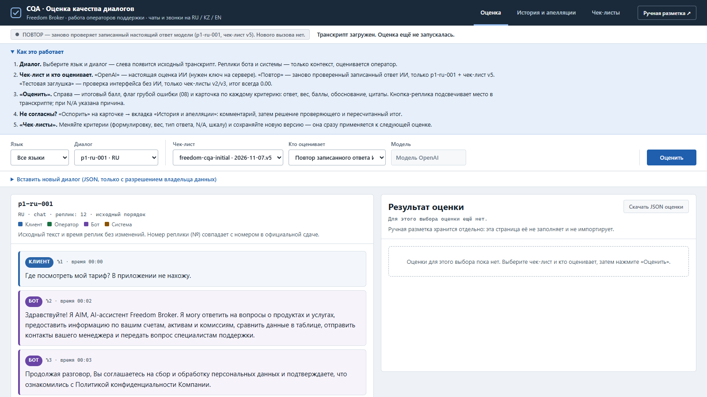
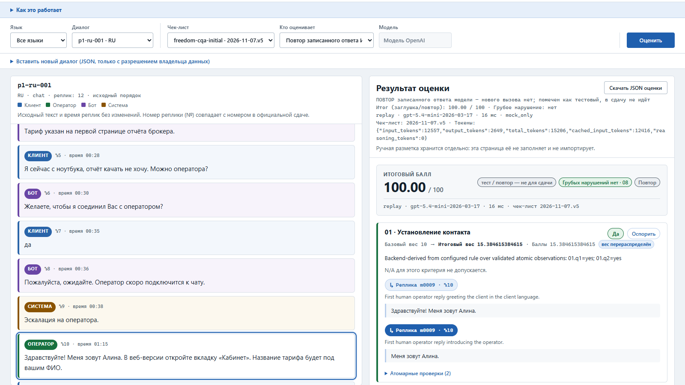

# План защиты CQA: команда sigmas, 4 человека, 5 минут

Здесь всё для защиты в одном месте: роли, запуск демо, сценарий по минутам, ответы на вопросы, запасной план и репетиция.

**Что кому читать:**
| Кто | Что читать |
|---|---|
| Тот, кто запускает демо на своём ноутбуке (Р2) | **Раздел 2 целиком, по шагам**, затем 3, 6 и 8 |
| Спикеры (Р1, Р3, Р4) | 1, 3, 4, 5 и 8 |
| Все | Раздел 7 — репетиция вместе |

**Разделы:**
1. Роли.
2. Запуск демо: подробная инструкция.
3. Сценарий на 5 минут.
4. Вопросы жюри.
5. Цифры.
6. Если что-то пошло не так.
7. Репетиция.
8. Шпаргалка.

Сценарий проверен реальным прогоном: 33 действия по сценарию — около 51 секунды кликов. Остальное время — речь.

**Главная мысль** (Р1 говорит её в начале и в конце):
> «Наша система оценивает работу оператора по чек-листу Freedom так, что каждую оценку можно проверить: у каждого балла есть цитата из диалога, у каждого N/A — причина, а спорную оценку можно оспорить и пересчитать».

---

## 1. Роли

Впишите имена.

| Роль | Кто | Время на сцене | Отвечает за |
|---|---|---|---|
| **Р1 · Ведущий** | ______ | 0:00–1:00 и финал | Задача, главная мысль, интерфейс. Держит таймер и раздаёт вопросы жюри по ролям |
| **Р2 · Оператор демо** | ______ | всё время за ноутбуком | Готовит ноутбук, делает все клики, при сбое переключает на скриншоты. Во время речи молчит |
| **Р3 · Спикер «Оценка»** | ______ | 1:00–3:00 | Оценка, цитаты, N/A, веса, как устроена проверка ответа модели |
| **Р4 · Спикер «Апелляции и чек-листы»** | ______ | 3:00–5:00 | Апелляция и пересчёт итога, редактор чек-листов, встраивание и защита данных |

**Если вас трое:** Р1 берёт ещё и часть Р4, Р2 по-прежнему только кликает.

**Сигналы времени.** Р1 стоит так, чтобы его видели Р3 и Р4:
- один поднятый палец — «осталась минута на твою часть»;
- кулак — «закругляйся, передавай слово».

---

## 2. Запуск демо: подробная инструкция для любого человека

Эту часть может выполнить человек без опыта программирования.
- Всё делается мышкой.
- Печатать нужно только слово `YES` и ключ проверяющего.
- Читайте по порядку и не пропускайте шаги.

### 2.1. Что это и что понадобится
**Что такое демо.** Это сайт, который работает прямо на вашем ноутбуке.
- **Чёрное окно** — «сервер», то есть сам сайт.
- **Браузер** — его экран.

Пока чёрное окно открыто, сайт работает. Закрыли окно — сайт выключился.

**Что нужно:**
- ноутбук с Windows 10 или 11 — лучше личный: на рабочих часто запрещено ставить программы;
- интернет — только один раз, накануне, для установки;
- около 15 минут на установку и 10 минут на репетицию;
- браузер Edge (он есть в любой Windows) или Chrome.

**Чего не нужно:**
- платить или регистрироваться;
- ключ OpenAI;
- интернет в день защиты.

**Совет.** Устанавливайте по видеозвонку (Zoom, Telegram, Google Meet) с демонстрацией экрана. Тогда кто-то из команды видит ваш экран и подсказывает.

### 2.2. Шаг 1 — установить Python (один раз, около 3 минут)
Python — программа, на которой написано демо. Её ставят один раз.

1. Откройте в браузере ссылку https://www.python.org/ftp/python/3.11.9/python-3.11.9-amd64.exe. Сразу начнётся скачивание файла `python-3.11.9-amd64.exe`.
2. Когда файл скачается, откройте его одним из способов:
   - в Edge — значок загрузок справа вверху → «Открыть файл»;
   - или в папке «Загрузки» дважды щёлкните по файлу.
3. Откроется окно «Install Python 3.11.9 (64-bit)». **Внизу окна поставьте галочку «Add python.exe to PATH».** Это самый важный пункт.
4. Нажмите верхнюю большую кнопку **«Install Now»**.
5. Если Windows спросит «Разрешить этому приложению вносить изменения на устройстве?», нажмите **«Да»**.

   Если Windows просит пароль администратора, а его у вас нет:
   - нажмите «Нет» и запустите установщик ещё раз;
   - **снимите** галочку «Use admin privileges when installing py.exe»;
   - галочку «Add python.exe to PATH» оставьте;
   - нажмите «Install Now».
6. Подождите 1–2 минуты. Когда появится **«Setup was successful»**, нажмите **«Close»**. Пункт «Disable path length limit» не трогайте.

### 2.3. Шаг 2 — скачать проект (1 минута)
1. Откройте https://github.com/Gaziz121/data-challenge-2026. Регистрироваться на GitHub не нужно.
2. Справа над списком файлов нажмите зелёную кнопку **«<> Code»**.
3. Внизу открывшегося меню нажмите **«Download ZIP»**.
4. В папку «Загрузки» скачается файл `data-challenge-2026-main.zip`, около 14 МБ.

### 2.4. Шаг 3 — распаковать (1 минута)
ZIP — это упакованная папка. Прямо из неё демо не запустится, её нужно распаковать.
1. Откройте Проводник (значок папки на панели задач) и слева выберите **«Загрузки»**.
2. Щёлкните **правой** кнопкой мыши по `data-challenge-2026-main.zip` → **«Извлечь все…»**. Если такого пункта нет, сначала выберите «Показать дополнительные параметры».
3. В окне «Извлечение сжатых ZIP-папок» ничего не меняйте и нажмите **«Извлечь»**.
4. Откроется новая папка `data-challenge-2026-main`. Внутри — ещё одна с тем же именем, откройте её.
5. Вы на месте, если видите папки `case`, `data`, `docs`, `src`, `tools`, `web` и файл `ПЛАН_ЗАЩИТЫ_КОМАНДЫ`.

**Совет.** Перетащите эту (внутреннюю) папку `data-challenge-2026-main` на Рабочий стол, чтобы в день защиты быстро её найти. Сделайте это **сейчас, до шага 4**. После первого запуска папку не перемещайте и не переименовывайте.

### 2.5. Шаг 4 — первый запуск (1–2 минуты, нужен интернет)
1. В папке проекта откройте `tools`, затем `demo`.
2. Там три файла: `demo-start`, `demo-reset`, `run-demo`. Дважды щёлкните **`demo-start`** — его тип «Сценарий команд Windows».

   `run-demo` открывать не нужно: двойной щелчок откроет его в Блокноте. Если так случилось, просто закройте Блокнот.
3. Windows может предупредить, что файл скачан из интернета:
   - окно «Открыть файл — предупреждение системы безопасности» → **«Запустить»**;
   - синее окно «Система Windows защитила ваш компьютер» → **«Подробнее»** → **«Выполнить в любом случае»**.
4. Откроется **чёрное окно**. В первый раз в нём появятся примерно такие строки:
   ```
   Первый запуск: создаю окружение Python (Python 3.11) в папке .venv...
   Ставлю pydantic 2.13.5 (нужен интернет, обычно меньше минуты)...
   Готово: окружение установлено, дальше демо работает без интернета.
   Запускаю CQA: http://127.0.0.1:8765/  (чек-лист official-v7.json, платных вызовов 0, ...). Остановить: Ctrl+C.
   Built ...\outputs\dev_review\index.html (60 conversations; ...)
   CQA local app: http://127.0.0.1:8765/
   Default mode: MOCK fixture. Human labels stay separate at /human-review/.
   ```
   - Английские строки — это нормально.
   - «Default mode: MOCK fixture» — тоже нормально: страница сама выберет нужный режим.
   - Со второго раза первых трёх строк не будет, запуск займёт пару секунд.
5. Через несколько секунд **сам откроется браузер** с адресом `http://127.0.0.1:8765/`. Если не открылся, откройте Edge или Chrome и введите этот адрес в адресную строку.
6. **Чёрное окно не закрывайте**: пока оно открыто, демо работает. Его можно свернуть кнопкой «_» справа вверху.

Если появится окно брандмауэра Windows, нажмите любую кнопку: на демо это не влияет.

### 2.6. Шаг 5 — проверить, что всё работает (1 минута)
В браузере должна открыться такая страница:



1. Наверху выбрана вкладка «Оценка». Слева — переписка клиента с оператором, справа — «Результат оценки».
2. Нажмите синюю кнопку **«Оценить»** справа.
3. Справа должно появиться **«ИТОГОВЫЙ БАЛЛ 100.00 / 100»**:



Если вы видите 100.00, всё установлено правильно. Выключите демо — закройте чёрное окно крестиком. Вкладку браузера тоже можно закрыть.

### 2.7. Как включать и выключать демо дальше
| Что нужно | Что сделать |
|---|---|
| Включить демо | Двойной щелчок `tools\demo\demo-start` |
| Включить «с чистого листа» (стереть всё, что нажимали на репетиции) | Двойной щелчок `tools\demo\demo-reset` → набрать `YES` → Enter |
| Выключить | Закрыть чёрное окно |
| Демо работает, а вкладку браузера закрыли | Открыть в браузере `http://127.0.0.1:8765/` |

**Что делает `demo-reset`.** Он показывает, сколько файлов накопилось на репетиции, и спрашивает: «Удалить …? Введите YES для подтверждения».

**Как правильно набрать `YES`:**
- раскладка клавиатуры — **английская** (переключение: Alt+Shift или Win+Пробел);
- **большими** буквами `YES`, затем Enter.

**Что может написать окно:**
- **«Отменено, ничего не удалено»** — слово набрано в русской раскладке или маленькими буквами. Закройте окно и запустите `demo-reset` ещё раз.
- **«Папки outputs\app нет — история уже чистая»** — стирать нечего, демо сразу запустится.
- **«Сервер CQA уже запущен»** после щелчка по `demo-start` — демо уже работает в другом чёрном окне. Браузер откроется сам. Это второе окно закройте, а первое оставьте.

### 2.8. Как устроен экран демо
- **Тёмная полоса сверху** — три вкладки: «Оценка», «История и апелляции», «Чек-листы».
- **«Как это работает»** — короткая справка. Щелчок по заголовку раскрывает и сворачивает её.
- **Строка выбора** — «Язык», «Диалог», «Чек-лист», «Кто оценивает», «Модель» и синяя кнопка **«Оценить»**. Поле «Модель» серое — его не трогаем.
- **Слева** — переписка. У каждой реплики подпись (Клиент, Бот, Система, Оператор), номер (№) и время.
- **Справа** — результат: итоговый балл и карточки критериев 01–08. На каждой карточке:
  - ответ («Да», «Нет» или N/A), вес и цитаты;
  - синяя кнопка **«Реплика … · №…»** подсвечивает нужную реплику слева;
  - кнопка **«Оспорить»** подаёт апелляцию.

### 2.9. Репетиция накануне (обязательно, около 10 минут)
1. Двойной щелчок `demo-reset` → `YES` → Enter.
2. Пройдите сценарий раздела 3 целиком: все действия Р2. Сверяйте цифры:
   - после «Оценить» — **100.00**;
   - на карточке 01 — «Итоговый вес **15.38**…»;
   - после апелляции — «Исходный итог: 100.00 → Пересмотренный итог: **92.31**»;
   - после нового критерия — 07 «**0 / 10**», «Итоговый вес **9.52**…».
3. Если всё совпало, вы готовы. Снова `demo-reset` → `YES`, затем закройте чёрное окно.

### 2.10. День защиты
**Взять с собой:**
- ноутбук и зарядку;
- переходник для проектора (HDMI), если у ноутбука нет такого разъёма;
- бумажку с ключом `demo-reviewer-key`.

**За 30 минут:**
1. Подключите зарядку.
2. Выключите уведомления:
   - Windows 11 — «Не беспокоить» в центре уведомлений;
   - Windows 10 — «Фокусировка внимания».
3. Закройте лишние программы: Telegram, почту, музыку.
4. Подключите проектор. Нажмите **Win+P** → «Повторяющийся» («Дублировать»): тогда на ноутбуке и на проекторе одна и та же картинка.

**За 10 минут:**
1. Двойной щелчок `tools\demo\demo-reset` → `YES` → Enter. Браузер откроется сам. Интернет не нужен.
2. В браузере:
   - **Ctrl+0** — масштаб 100%. Если на проекторе не помещается, **Ctrl+минус** → 90%;
   - **F11** — полный экран. Выйти — снова F11.
3. Проверьте экран, как на первой картинке раздела 2.6:
   - вкладка «Оценка»;
   - «Диалог» = `p1-ru-001 · RU`;
   - «Кто оценивает» = «Повтор записанного ответа ИИ»;
   - «Чек-лист» = `…2026-11-07.v5`.

   **«Оценить» заранее не нажимайте** — это делается при жюри.
4. Откройте в Проводнике папку `docs\defense\screenshots` и сверните её. Это запасной план (раздел 6). Видео демо, если его прислали, тоже держите открытым в соседнем окне.
5. **Ключ проверяющего** — `demo-reviewer-key`. Перед вводом переключите раскладку на английскую. Имена и комментарии в апелляции пишутся по-русски.

### 2.11. Если что-то не получается
| Что видите | Что делать |
|---|---|
| Двойной щелчок открыл Блокнот | Вы открыли `run-demo`. Закройте Блокнот и щёлкните `demo-start` |
| Окно пишет, что `run-demo.ps1` не существует или не найден | Запуск прямо из ZIP. Сделайте шаг 3 («Извлечь все…») и запускайте из распакованной папки |
| «Python не найден», и открылась страница python.org | Повторите шаг 1 с галочкой «Add python.exe to PATH». Не помогло — перезагрузите ноутбук и снова `demo-start` |
| «Не удалось установить pydantic» | Нет интернета. Подключитесь и снова `demo-start` |
| «Порт 8765 занят другой программой» | Перезагрузите ноутбук и снова `demo-start` |
| Браузер не открылся сам | Откройте Edge или Chrome и введите `http://127.0.0.1:8765/` |
| «Не удаётся получить доступ к сайту» или «Локальный сервер CQA недоступен» | Чёрное окно закрыто. Снова `demo-start`, затем обновите страницу (F5) |
| «Отменено, ничего не удалено» | `YES` набрано по-русски или маленькими буквами. Закройте окно и снова `demo-reset` |
| «Для продолжения нажмите любую клавишу…» | Демо остановилось. Прочитайте текст выше. Если он красный — сфотографируйте. Нажмите любую клавишу, окно закроется |
| Красный текст в чёрном окне | Сфотографируйте телефоном и отправьте в чат команды |
| Страница тёмная или цвета странные | Выключите тёмную тему или расширение Dark Reader для этого сайта |
| Антивирус или рабочий ноутбук не даёт запустить | Возьмите другой ноутбук. На защите показывайте скриншоты и видео (раздел 6) |

**Чего делать не нужно:**
- выбирать «OpenAI — настоящая оценка ИИ»: без ключа она не работает, кнопка «Оценить» станет серой;
- закрывать чёрное окно во время показа;
- перемещать или переименовывать папку проекта после первого запуска;
- вводить какие-либо ключи и пароли, кроме `demo-reviewer-key`.

### 2.12. Что именно работает в демо (чтобы честно отвечать)
| «Кто оценивает» | Чек-лист | Диалог | Что получится |
|---|---|---|---|
| **Повтор записанного ответа ИИ** | только v5 | только p1-ru-001 | **100.00** — настоящий ответ модели gpt-5.4-mini, записан заранее и заново проходит все проверки |
| **Тестовая заглушка (без ИИ)** | v2 / v3 и их правки | любой из 60 синтетических | **0.00** — проверка проводки, не качества |
| Тестовая заглушка | v4–v7 | любой | отказ проверки, так задумано |
| **OpenAI — настоящая оценка ИИ** | любой, включая вашу правку | любой | реальная оценка, около 14 с и 1–2 цента; **нужен ключ** |

Если выбрано неработающее сочетание, под панелью появляется жёлтая подсказка с кнопкой-исправлением.

**Живой режим — только если появится ключ OpenAI.**
1. Создайте файл вне папки проекта, например `C:\secure\cqa.env`, с одной строкой `OPENAI_API_KEY=...`.
2. Запустите:
   ```powershell
   powershell -ExecutionPolicy Bypass -File .\tools\demo\run-demo.ps1 -Live -EnvFile C:\secure\cqa.env
   ```
3. «Кто оценивает» = OpenAI → любой диалог → «Оценить».

Ключ никогда не кладём в репозиторий и не пишем в командной строке.

### 2.13. Для технически подкованных: Git, macOS и Linux
**Windows (PowerShell), через Git:**
```powershell
git clone -c core.autocrlf=false https://github.com/Gaziz121/data-challenge-2026.git
cd data-challenge-2026
```
Затем двойной щелчок `tools\demo\demo-start.cmd` — окружение создастся само.
- `core.autocrlf=false` обязателен: с переводами строк Windows не сходится контрольная сумма датасета, и сервер не стартует. В ZIP с GitHub переводы строк уже правильные.
- Обновить уже скачанную папку: `git pull --ff-only`.

**macOS / Linux** (на Mac не проверялось):
- Python 3.11 для Mac: https://www.python.org/ftp/python/3.11.9/python-3.11.9-macos11.pkg
- Проект можно скачать тем же ZIP. Тогда в Терминале перейдите в его папку командой `cd` и пропустите первую строку ниже.

```sh
git clone https://github.com/Gaziz121/data-challenge-2026.git && cd data-challenge-2026
python3 -m venv .venv && .venv/bin/pip install "pydantic==2.13.5"
CQA_REVIEWER_KEY=demo-reviewer-key PYTHONPATH=src .venv/bin/python -m cqa.web --port 8765 \
  --checklist src/cqa/checklists/official-v7.json --live-call-limit 0
```
Потом откройте http://127.0.0.1:8765/.
- **Остановить** — Ctrl+C.
- **Очистить историю репетиций** — остановить сервер и удалить папку `outputs/app`.
- **Платные вызовы:** `--live-call-limit 0` гарантирует, что их не будет ни одного.

---

## 3. Сценарий на 5 минут по ролям (план организаторов: 1 / 2 / 1 / 1)

### 0:00–1:00 · Р1 · Задача и интерфейс
**Р1 говорит:**
> «Контроль качества диалогов обычно ручной, медленный и субъективный. Мы проверяем каждый диалог по восьми критериям чек-листа организаторов на русском, казахском и английском. [Главная мысль.] Сверху три раздела: оценка, история с апелляциями и редактор чек-листов. Слева исходный транскрипт без изменений: клиент спрашивает, где посмотреть тариф. Сначала отвечает бот, затем системное сообщение об эскалации — это только контекст, их не оцениваем. Оценивается живой оператор Алина».

**Р2 делает:**
- раскрыть и свернуть «Как это работает»;
- по желанию: «Язык» = KZ на 3 секунды, затем «Все языки» → `p1-ru-001`.

**Жюри видит:** русский интерфейс, цветные роли «Клиент / Бот / Система / Оператор», номер и время каждой реплики.

**Передача слова:**
> Р1: «Теперь [имя Р3] покажет, как система ставит оценку».

### 1:00–3:00 · Р3 · Оценка, цитаты, N/A, итог
**Р2:** нажать **«Оценить»**.

**Р3:**
> «Это настоящий ответ модели OpenAI gpt-5.4-mini, записанный заранее. Сейчас система заново прогоняет его через все проверки, поэтому демо не зависит от интернета. В рабочем режиме та же кнопка вызывает модель: около 14 секунд и 1–2 цента на диалог».

**Жюри видит:** «ИТОГОВЫЙ БАЛЛ **100.00** / 100», отдельно «Грубых нарушений нет · 08».

**Р2:** на карточке «01 · Установление контакта» нажать синюю кнопку **«Реплика m0009 · №10»**.

**Р3:**
> «Каждый ответ подтверждён цитатой. По клику подсвечивается реплика в транскрипте: оператор поздоровался и представился».

**Р2:** пролистать до карточек 02 и 03.

**Р3:**
> «02 "Выявление потребности" и 03 "Идентификация" — N/A. Клиент сразу ясно задал вопрос, а общий вопрос о тарифе не требует идентификации. Причина N/A написана явно. Веса 15 и 20 по правилам чек-листа перераспределены на остальные критерии, поэтому у 01 вес 10 превратился в 15.38. Итог считает наш код, а не модель».

**Если есть время.** Р2 раскрывает «Атомарные проверки» на любой карточке. Р3:
> «Модель не ставит баллы напрямую. Она отвечает на простые факты с точными цитатами. Наш код проверяет, что цитата дословно есть в тексте, а роль и порядок верные, и по правилам выводит ответ. Если факты не сходятся, оценка отклоняется, а не придумывается».

**Передача слова:**
> Р3: «А если оператор не согласен с оценкой? Это покажет [имя Р4]».

### 3:00–4:00 · Р4 · Оспорить оценку, решение проверяющего, новый итог
**Р4:**
> «Посмотрим на 07 "Завершение". Модель засчитала "Пожалуйста. Хорошего вечера!". Но по чек-листу нужно подвести итог или предложить помощь и попрощаться. Оспорим».

**Р2:**
1. На карточке 07 нажать **«Оспорить»** — откроется вкладка «История и апелляции», критерий 07 уже выбран.
2. «Какая оценка верна» = **нет**, «Ваше имя» = `Оператор`, комментарий «Только прощание, нет итога и предложения помощи» → **«Подать апелляцию»**.

**Р4:**
> «Проверяющий видит спорную оценку, комментарий и сам фрагмент диалога».

**Р2:**
1. «Имя проверяющего» = `Проверяющий`, «Ключ проверяющего» = `demo-reviewer-key` (перед ключом переключить раскладку на английскую).
2. В карточке апелляции: «Изменить оценку», новая оценка **нет**, причина «Нет итога и предложения помощи» → **«Сохранить решение»**.

**Жюри видит:** «Исходный итог: **100.00** → Пересмотренный итог: **92.31**». Строка 07 подсвечена.

**Р4:**
> «Итог пересчитан той же официальной арифметикой. Исходная оценка не изменена, решение с причиной сохранено отдельно».

### 4:00–5:00 · Р4 · Изменение критерия, применение чек-листа · Р1 · финал
**Р2:**
1. Вкладка **«Чек-листы»** → «Исходная версия» = `…2026-11-07.v3`.
2. У критерия 07:
   - «Название» = «Предложение дальнейшей помощи»;
   - «Вес» = 10;
   - «Тип ответа» = **Числовая шкала**;
   - снять «N/A допускается»;
   - три коротких «Описания уровня».
3. **«Сохранить как новую версию»** → **«Оценить с этой версией →»**.
4. «Кто оценивает» = «Тестовая заглушка (без ИИ)» → **«Оценить»**.

**Жюри видит:** 07 теперь «0 / 10» (шкала), «Базовый вес 10 → Итоговый вес **9.52**».

**Р4:**
> «Новый критерий применился через настройки, без кода. Версии неизменяемые, каждая оценка хранит свою. Здесь мы проверили проводку заглушкой, а в рабочем режиме эта версия уходит в модель».

**Р1 (5 секунд):** главная мысль ещё раз и «Спасибо, готовы ответить на вопросы».

---

## 4. Вопросы жюри: кто отвечает

Р1 слушает вопрос и называет, кто отвечает. Ответ — 20–30 секунд, без чтения с листа.

### Р3 · Оценка и модель
- **«Почему в демо повтор, а не живой вызов?»**
  Чтобы показ не зависел от интернета и был воспроизводим. Это настоящий ответ модели, его заново проверяют все наши фильтры. Живой режим включается одним флагом запуска.
- **«Как вы боретесь с галлюцинациями?»**
  - каждая цитата обязана дословно существовать в диалоге;
  - роли и порядок реплик проверяются;
  - утверждение «ничего не было» требует ссылки на весь диалог;
  - противоречия блокируют оценку.

  Ответ, не прошедший проверку, получает статус «ошибка», а не ноль.
- **«Какая точность?»**
  Эталона для DEV организаторы не дали, поэтому точность в процентах честно не называем. Зато каждую оценку можно проверить и оспорить. Известный перекос — 07: модель засчитывает одно прощание. Мы уточнили формулировку в новых версиях чек-листа, а апелляция ловит такие случаи — это и было показано.
- **«Как работает N/A?»**
  Только где чек-лист разрешает и только при выполненном условии. Вес исключённого критерия пропорционально делится между остальными, максимум остаётся 100.
- **«А грубые ошибки?»**
  Критерий 08 — отдельный флаг: оскорбление, платная услуга в обход компании, утечка данных. По правилам организаторов он итог не обнуляет, но виден отдельно.
- **«Почему не локальная модель? Сколько стоит?»**
  Нужен строгий структурированный ответ и хорошие RU и KZ при низкой цене: около $0.013–0.023 и 14 секунд на диалог. Провайдер вынесен в отдельный интерфейс, локальную модель можно подключить позже.
- **«Что если модель вернула мусор?»**
  Оценка отклоняется и видна как отчёт с причинами. В официальном файле — `status: "error"` с причиной, никогда не ноль.

### Р4 · Апелляции, чек-листы, внедрение
- **«Как добавить новый критерий?»**
  Вкладка «Чек-листы»: добавить или изменить, сохранить новую версию. Она сразу выбирается для оценки, код не нужен.
- **«Кто решает апелляцию?»**
  Отдельный человек с ключом проверяющего. Он подтверждает или меняет оценку с причиной. Исходная оценка не меняется, история хранится.
- **«Встраивание в Dynamics 365?»**
  Один корневой HTML-блок, стили с префиксом, без CDN и внешних шрифтов. Встраивается как HTML web resource, данные идут через API сервера.
- **«Защита данных?»**
  - реальные звонки во внешние сервисы не отправляются;
  - новый диалог оценивается только с разрешением владельца данных, иначе отказ 403;
  - ключей в репозитории нет.

### Р1 · Общие вопросы
- **«Казахский и английский?»**
  Тот же чек-лист и тот же движок. В наборе 15 казахских и 15 английских диалогов.
- **«Звонки?»**
  Транскрипты звонков оцениваются так же. Звук мы не анализируем — по ТЗ это необязательно. Для вставленного звонка есть ссылка «Открыть запись».
- **«Как проверяли качество кода?»**
  Около 230 автотестов и 81 независимый тест QA, проверки GitHub зелёные.

### Как устроено решение (одна схема для любых вопросов)
```
диалог → модель отвечает на факты с цитатами → проверки (цитата есть? роль и порядок? «ничего не было» подтверждено всем диалогом?)
       → ответ по правилам чек-листа → точный расчёт баллов (N/A, перераспределение, округление) → результат + аудит
```
- **ИИ** — облачная модель OpenAI gpt-5.4-mini со строгим JSON-форматом ответа.
- **Наш код (Python)** решает, можно ли верить ответу, и считает баллы. Ошибочный ответ модели не превращается в оценку.
- **Апелляции** хранятся отдельно, исходная оценка неизменна. Пересчёт идёт той же функцией.
- **Чек-листы** — данные, а не код. Каждая версия сохраняется с хэшем.
- **Интерфейс** — чистые HTML/CSS/JS без внешних библиотек.

### Честные ограничения (если спросят — говорим прямо)
- Точность против эталона организаторов не измерена: эталона для разработки нет.
- Демо без ключа — повтор одного записанного ответа. Живая оценка требует ключ OpenAI.
- Обоснования и пояснения к цитатам — исходный текст модели на английском. Интерфейс их не переводит, чтобы не искажать.
- «Результаты секций» не реализованы: в чек-листе нет секций.
- Звук звонков не анализируется.

---

## 5. Цифры, которые все четверо должны помнить
| Что | Значение |
|---|---|
| Модель, цена, время | gpt-5.4-mini · около $0.013–0.023 за диалог · около 14 с |
| Критерии и веса | 01–07: 10 / 15 / 20 / 20 / 15 / 15 / 5; 08 — отдельный флаг без баллов |
| Перераспределение | 02 и 03 = N/A → применимый вес 65 → вес 01: 10 → 15.38 |
| Апелляция в демо | 07 «да» → «нет»: 100.00 → 92.31 |
| Новый критерий | 07 шкала, вес 10 → итоговый вес 9.52 (= 100 · 10 / 105) |
| Данные | 60 синтетических диалогов DEV: RU 30 / KZ 15 / EN 15 |
| Ключ проверяющего | `demo-reviewer-key` |

---

## 6. Если что-то пошло не так (Р2 действует, Р1 говорит)

Р1 говорит: «Пока перезапускаем, покажем на кадрах». Р2 открывает скриншоты.

| Ситуация | Что делает Р2 |
|---|---|
| Страница не открывается | Двойной клик `tools\demo\demo-start.cmd`, подождать браузер |
| «Локальный сервер CQA недоступен» | Окно сервера закрыто → `demo-start.cmd`, затем обновить страницу |
| Страница тёмная или «красная» | Выключить Dark Reader и тёмный режим для 127.0.0.1 |
| Жёлтая подсказка над результатом | Нажать синюю ссылку в ней («Взять …v3» / «Перейти на p1-ru-001 + v5») |
| «Оценить» серая | Выбран OpenAI без ключа → «Кто оценивает» = «Повтор…» |
| Апелляция по 07 «уже открыта» | Следы репетиции: `tools\demo\demo-reset.cmd` или открыть оценку заново |
| Интерфейс выглядит старым | Ctrl+F5 |
| Всё сломалось | Показать скриншоты 01–09 из `docs\defense\screenshots`, сценарий тот же |

**Скриншоты по сценарию** (`docs\defense\screenshots`):
- 01 интерфейс и диалог;
- 02 итог и переход к реплике;
- 03 N/A с причиной;
- 04 критерий 07 до апелляции;
- 05 апелляция глазами проверяющего;
- 06 решение и новый итог 92.31;
- 07 исходный и новый итог на карточке;
- 08 замена критерия в редакторе;
- 09 новая версия применена.

---

## 7. Репетиция (вся команда, около 40 минут)
1. **Прогон 1 — с листа.** Каждый читает свою часть, Р2 кликает, Р1 засекает время. Цель — уложиться в 5:00.
2. **Прогон 2 — без листа.** Р1 подаёт сигналы времени, передачи слова — дословно по разделу 3.
3. **Прогон 3 — «авария».** На 2-й минуте Р2 закрывает окно сервера. Команда переходит на скриншоты и спокойно продолжает.
4. **Вопросы.** Р2 зачитывает вопросы из раздела 4 вразнобой, Р1 сразу называет, кто отвечает. Ответ не дольше 30 секунд.
5. **После репетиции** Р2 запускает `tools\demo\demo-reset.cmd` → `YES`.

---

## 8. Шпаргалка (распечатать для Р2 и Р1)
```
ПОДГОТОВКА (Р2)  tools\demo\demo-reset.cmd → YES · без тёмной темы · Ctrl+0 · F11 · ключ: demo-reviewer-key

0:00 Р1  Главная мысль → вкладки → транскрипт (бот/система = контекст, оцениваем оператора Алину) → [KZ на 3 сек]
1:00 Р3  «Оценить» → 100.00, 08 отдельно → 01: «Реплика m0009 · №10» → 02/03 N/A + причина,
         вес 01: 10 → 15.38 → «модель даёт факты с цитатами, баллы считает код»
3:00 Р4  07 «Оспорить» → нет / Оператор / «только прощание» → «Подать апелляцию» →
         Проверяющий / demo-reviewer-key / «Изменить оценку» → нет / причина → «Сохранить решение» → 100.00 → 92.31
4:00 Р4  «Чек-листы» → v3 → 07: название, вес 10, «Числовая шкала», без N/A, 3 описания →
         «Сохранить как новую версию» → «Оценить с этой версией →» → «Тестовая заглушка» → «Оценить» → 07: 0/10, вес 9.52
5:00 Р1  Главная мысль ещё раз → «Готовы ответить на вопросы»

СБОЙ  Р1: «покажем на кадрах» · Р2: docs\defense\screenshots 01–09
```
